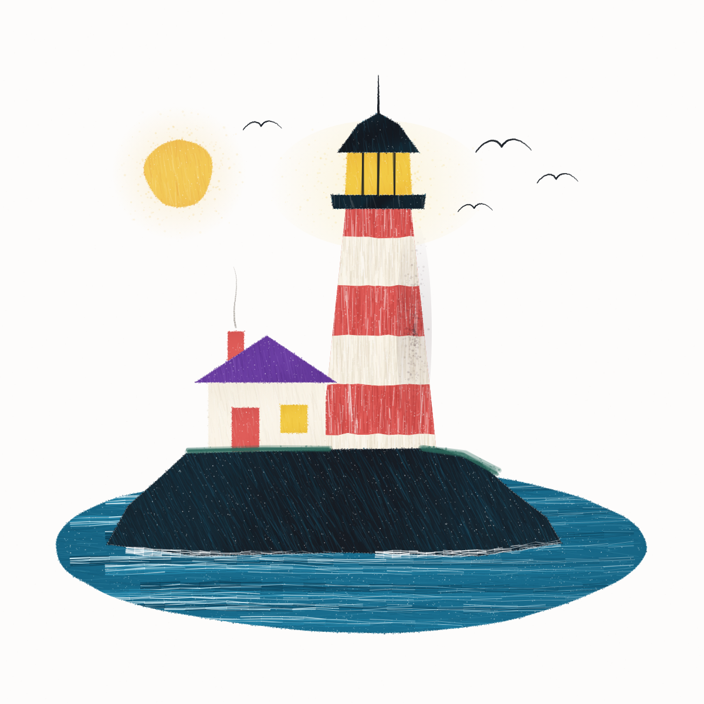
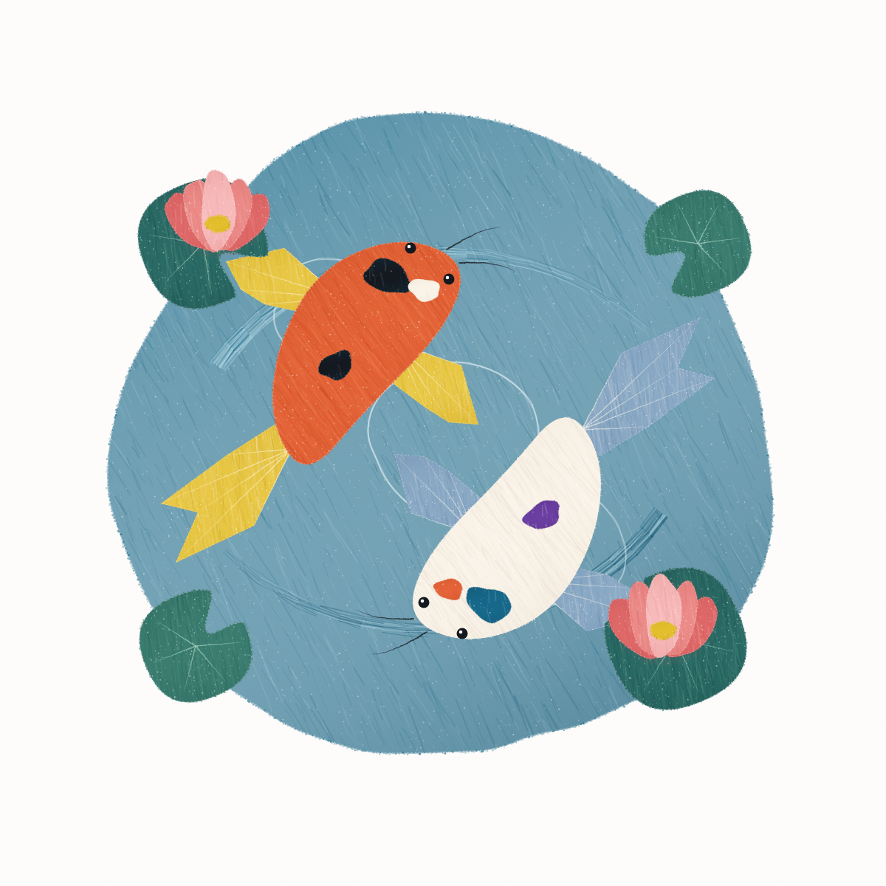
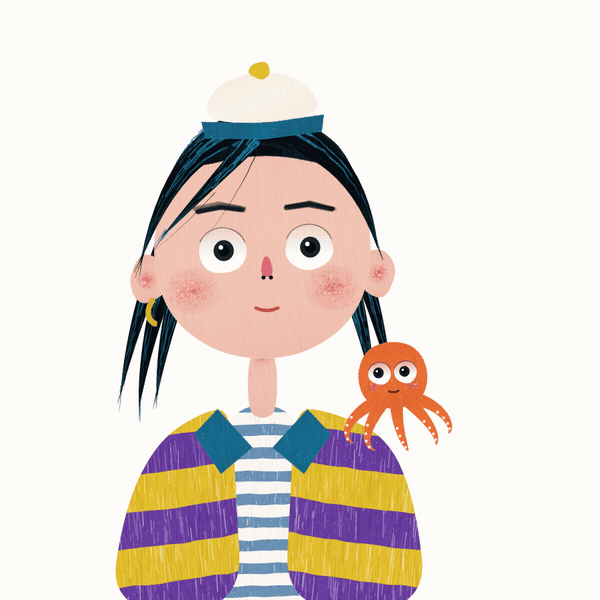

# Gemini Hydrogen Art

Pure procedural editorial illustrations generated entirely in code using vanilla JavaScript and HTML5 Canvas 2D — zero external libraries, zero image assets, zero build steps.

All six artworks were coded and visually iterated with **Gemini 4 Hydrogen** on top of a custom painterly engine ([`src/painter.js`](src/painter.js)) that simulates colored-pencil hatching, paper-tooth speckles, dry-brush ink streaks, stippled chalk blush, and feathered tapered hair locks.

## Example Artworks

| | |
| :---: | :---: |
| <br>**The Moody Girl** — Character Portrait ([`01-character-portrait.js`](src/subjects/01-character-portrait.js)) | <br>**Midnight Marmalade** — Botanical Pet ([`02-tuxedo-cat.js`](src/subjects/02-tuxedo-cat.js)) |
| <br>**Fox in the Brambles** — Woodland Wildlife ([`03-fox-in-autumn.js`](src/subjects/03-fox-in-autumn.js)) | <br>**Quiet Morning Table** — Editorial Still Life ([`04-still-life-teatime.js`](src/subjects/04-still-life-teatime.js)) |
| <br>**Cliffside Beacon** — Landscape ([`05-coastal-lighthouse.js`](src/subjects/05-coastal-lighthouse.js)) | <br>**Lantern Pond** — Botanical & Aquatic ([`06-botanical-koi-pond.js`](src/subjects/06-botanical-koi-pond.js)) |

### Procedural Animation (50 Frames @ 10 FPS)

|  |
| :---: |
| **The Little Sailor & the Cap-Stealing Octopus** — Single self-contained HTML animation ([`sailor-and-octopus.html`](sailor-and-octopus.html) · [Live page](https://pages.hashir.dev/sailor-and-octopus)) |

Open [`sailor-and-octopus.html`](sailor-and-octopus.html) directly in any browser (no server needed) to play/pause the 5-second loop, scrub individual frames `0..49`, or download any frame as PNG.

## Running Locally

### Interactive Gallery

Serve the directory over HTTP (required for ES module imports) and open `index.html`:

```bash
python3 -m http.server 8080
```

Visit `http://localhost:8080` to browse all artworks, click any piece to inspect at `1200×1200`, click **Re-seed Texture** to regenerate paper grain and pencil strokes, or download individual PNGs.

### Batch Render to PNG

Export all registered artworks at `1200×1200` into `renders/` using Node.js and headless Google Chrome (no npm dependencies):

```bash
node render.mjs
```

> `render.mjs` expects Google Chrome at `/Applications/Google Chrome.app/Contents/MacOS/Google Chrome` on macOS. Update `chromePath` in [`render.mjs`](render.mjs) if running on Linux or Windows.

---

## How to Use This Code with Gemini 4 Hydrogen

You can use **Gemini 4 Hydrogen** (in T3 Code, Antigravity, or any agent harness) to design new subjects, extend the painterly primitives, and visually QA the rendered PNGs in a tight loop.

### 1. Subject Module Contract

Every artwork in `src/subjects/` exports an `artwork` object on a normalized `1200×1200` canvas coordinate space:

```js
import {
  createRng,
  drawPaperBackground,
  fillPastelShape,
  pointedLeafPts,
} from '../painter.js';

export const artwork = {
  id: '07-my-subject',
  title: 'My Subject',
  category: 'Still Life',
  medium: 'Colored pencil & dry-brush ink',
  palette: ['#0a0d11', '#14698a', '#e3bf2d', '#df6968'],
  draw(ctx, width, height, seed = 707) {
    const rng = createRng(seed);
    ctx.save();
    ctx.scale(width / 1200, height / 1200);

    drawPaperBackground(ctx, 1200, 1200, rng, '#fdfcfb');
    // Layer back-to-front using src/painter.js primitives...

    ctx.restore();
  },
};
```

Register it in [`src/registry.js`](src/registry.js) so both [`index.html`](index.html) and [`render.mjs`](render.mjs) pick it up automatically.

### 2. Core Primitives in `src/painter.js`

- **`fillPastelShape(ctx, pts, opts)`** — Fills any polygon with directional colored-pencil strokes, paper-tooth speckles, and edge grain. Set `sharp: true` for crisp corners (architecture, leaves, animal ears, pottery rims) and leave `false` for soft organic curves.
- **`fillStripedPastelShape(ctx, pts, stripes, opts)`** — Clips curved or straight horizontal bands with vertical crayon/knit rib texture (sweaters, striped ceramics, table linens, lighthouses).
- **`drawTaperedHairLock(ctx, p0, p1, p2, p3, opts)`** — Draws a wide-root hair clump tapering to a sharp feathered tip with split dry-brush wisps past the end.
- **`drawDryBrushRibbon(ctx, p0, p1, p2, p3, opts)`** — Multi-bristle tapered stroke along a cubic Bezier for fur highlights, water currents, and sea foam.
- **`drawPainterlyTube(ctx, p0, p1, p2, p3, opts)`** — Solid-core curved stroke for handles, tails, and hoop earrings.
- **`drawStippledBlush(ctx, cx, cy, rx, ry, color, opts)`** — Chalk-grain radial stippling for cheeks, glowing lanterns, shadows, and fruit ripeness.
- **`pointedLeafPts(cx, cy, rx, ry, rot, n, rng)`** — Tapered botanical leaf points (pair with `sharp: true`).
- **`drawWispyStrand` / `drawCharcoalMark` / `drawGouacheEye`** — Stray hairs, whiskers, steam, rough brows, and expressive storybook eyes.

### 3. Prompting Gemini 4 Hydrogen for New Subjects

Give Gemini 4 Hydrogen a clear style anchor, composition notes, and tell it to render and visually inspect the PNG before finishing:

```text
Using the procedural engine in src/painter.js, create a new subject module
src/subjects/07-vintage-bicycle.js on a 1200x1200 canvas in the same
colored-pencil, dry-brush ink, and stippled-chalk style.

Subject & details:
- A slightly crooked teal vintage bicycle with a woven basket holding
  pointed botanical sprigs and mustard wildflowers.
- Crisp white paper negative space (#fdfcfb), warm coral stippled accents,
  and wispy ink spokes/stray lines.
- Use sharp: true on pointed leaves, basket rim, and crisp corners; avoid
  blobby rounded ends.

Register it in src/registry.js, run `node render.mjs`, inspect the
rendered PNG directly, and refine any proportions or edge artifacts.
```

For a **50-frame (5 seconds @ 10 fps) procedural animation** in a single self-contained HTML file (like [`sailor-and-octopus.html`](sailor-and-octopus.html)), ask Gemini 4 Hydrogen to inline the painterly primitives, cache the paper background once, use a 2-frame boil seed (`Math.floor(f / 2) % 3`) to avoid harsh per-frame flicker, pre-warm an offscreen 50-frame canvas cache, and verify key frames with headless Chrome + `ffmpeg`.

### 4. Recommended Workflow Loop with Gemini 4 Hydrogen

1. **Generate** — Ask Gemini 4 Hydrogen to write the new `src/subjects/*.js` file (or single-file HTML animation) and register it in [`src/registry.js`](src/registry.js).
2. **Render** — Have it run `node render.mjs` to produce `renders/<id>.png` (or export 50 frames to a GIF).
3. **Inspect & Critique** — Have it view the rendered frames directly (and point out any rounded ends, floating edges, or flat regions). Because all geometry and textures live in deterministic code, small tweaks to control points, `sharp: true`, or `drawTaperedHairLock` immediately improve the render.

## Project Structure

```text
.
├── index.html                   # Interactive browser gallery + PNG downloader
├── sailor-and-octopus.html      # Self-contained 50-frame @ 10 fps animation
├── render.mjs                   # Zero-dependency Node + headless Chrome PNG exporter
├── renders/                     # Pre-rendered 1200x1200 PNGs & 10 fps animated GIF
└── src/
    ├── painter.js               # Pure JS Canvas 2D painterly & texture engine
    ├── registry.js              # Exports ARTWORKS list
    └── subjects/                # Individual 1200x1200 procedural artwork modules
```

